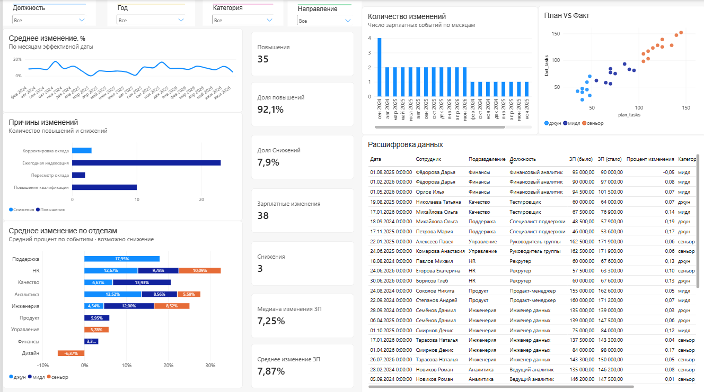
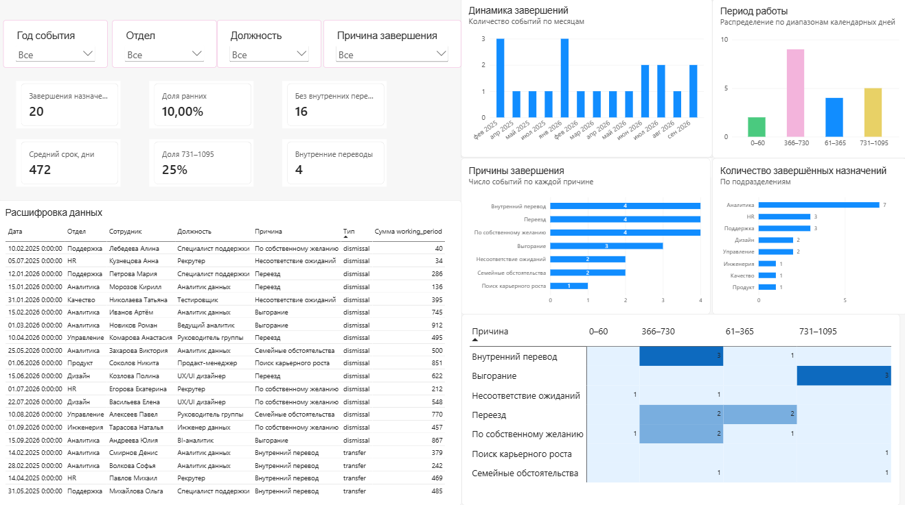

# Neoflex — аналитика кадровых данных: DWH, ETL, DQ и Power BI

Учебный проект по проектированию и реализации обработки кадровых данных в PostgreSQL. В репозитории представлены функциональные требования, модель хранения данных, SQL-процедуры обновления аналитических витрин, проверки качества данных, BPMN-схемы и демонстрационный отчёт Power BI.

Проект охватывает два направления: анализ завершённых кадровых назначений и анализ индивидуальных изменений заработной платы. Загрузка из внешних систем и запуск по расписанию находятся за границами реализации.

## Задача проекта

Кадровые и зарплатные данные поступают из разных источников, что затрудняет их сопоставление и анализ. В рамках проекта подготовлены структура хранения, правила обработки и визуализация данных для следующих пользователей:

- **HR-директор:** анализ причин завершения назначений и продолжительности работы, с разделением увольнений и внутренних переводов.
- **C&B-аналитик:** анализ повышений и снижений заработной платы, причин изменений, должностей и условных категорий нагрузки.
- **Data Steward:** просмотр результатов DQ, отклонённых записей и состояния ETL.

Роли описывают назначение материалов и требования к доступу; отдельная настройка прав этих ролей в SQL не реализована.

## Состав работы

- Функциональные требования: роли, пользовательские сценарии, правила расчётов и маппинг полей.
- Структура DWH: семь основных HR-таблиц, три промежуточные таблицы `stg_*`, две витрины и служебные таблицы.
- Инкрементальное обновление витрин `turnover` и `salary_change` по времени загрузки исходных записей.
- Семь групп проверок качества данных, журнал проблем и отдельные таблицы отклонённых записей.
- BPMN-модели оркестрации, обновления витрин и выполнения DQ.
- Демонстрационные данные, включая ошибочные записи для проверки обработки исключений.
- Отчёт Power BI со страницами «Изменение ЗП» и «Текучка».

## Артефакты

### Функциональные требования

- [Функциональные требования](./requirements/functional-requirements.docx) — бизнес-проблема, пользовательские роли, сценарии, состав витрин, алгоритмы расчётов и маппинг полей.

### Модель данных и SQL

| Файл | Назначение |
|---|---|
| [dwh-schema.sql](./sql/dwh-schema.sql) | Создание исходных и промежуточных таблиц, витрин, карантина, журнала ETL и объектов DQ. |
| [dq.sql](./sql/dq.sql) | Функция определения условной категории нагрузки и процедура проверок `CHECK_1`–`CHECK_7`. |
| [etl.sql](./sql/etl.sql) | Процедуры обновления витрин и общий запуск `etl_run_all()`. |
| [demo_data.sql](./data/demo_data.sql) | Демонстрационные кадровые данные, история зарплат, планы задач и примеры ошибок. |
| [run.sql](./sql/run.sql) | Запуск ETL и запросы для просмотра статуса, результатов DQ, витрин, карантина и контрольных точек. |

### BPMN-диаграммы

- [Оркестрация ETL и DQ](./diagrams/bpmn-orchestration.svg) — общий запуск, блокировка параллельного выполнения и обработка результата.
- [Обновление витрины завершённых назначений](./diagrams/bpmn-etl-turnover.svg) — отбор изменённых назначений, проверка данных и обновление витрины и карантина.
- [Обновление витрины изменений зарплаты](./diagrams/bpmn-etl-salary-change.svg) — определение затронутых назначений и пересчёт их зарплатной истории.
- [Проверки качества данных](./diagrams/bpmn-dq-checks.svg) — выполнение семи групп проверок и регистрация проблем.
- [Исходник BPMN-схем](./diagrams/bpmn.drawio) — файл для открытия в draw.io.

### Отчёт Power BI

[dashboard.pbix](./dashboard/dashboard.pbix) содержит две страницы:

- **«Изменение ЗП»:** количество повышений и снижений, среднее и медианное изменение, причины изменений, динамика по месяцам, план и факт задач, детализация событий.
- **«Текучка»:** количество завершённых назначений, внутренние переводы, причины завершения, продолжительность работы и распределение по подразделениям.

**Страница «Изменение ЗП»**



**Страница «Текучка»**



## Логика обработки данных

### Витрина `turnover`

Единица учёта — кадровое назначение с ключом `assignment_id`. В витрину включаются назначения с заполненной датой завершения `end_date`, в том числе завершения при внутренних переводах. Количество строк витрины не равно количеству увольнений из компании.

Продолжительность работы рассчитывается в календарных днях: `working_period = end_date - start_date`. При совпадении дат результат равен нулю.

Записи с датой завершения раньше даты начала или отсутствующей причиной направляются в `turnover_rejected`. Корректные завершённые назначения записываются в `turnover`. При изменении назначения его прежнее состояние удаляется из витрины и карантина; если дата завершения исправлена на `NULL`, назначение перестаёт отображаться как завершённое.

### Витрина `salary_change`

Единица учёта — событие изменения зарплаты с ключом `salary_event_id`. Предыдущая зарплата определяется с помощью `LAG` внутри одного кадрового назначения, по дате вступления зарплаты в силу.

Процент изменения рассчитывается по формуле:

```text
(текущая зарплата − предыдущая зарплата) × 100 / предыдущая зарплата
```

Результат округляется до двух знаков. Первая запись истории и события без изменения суммы в витрину не включаются. Если предыдущая зарплата равна нулю, событие помещается в `salary_change_rejected`.

Для назначения, затронутого изменениями в `employee_salary_history`, `plan_execution` или `staffing_table`, пересчитывается вся зарплатная история. Действующий план задач выбирается на дату зарплатного события.

Поле `grade` отражает **условную учебную категорию по плановому количеству задач**, а не оценку квалификации сотрудника:

| План задач | Категория |
|---|---|
| 0–50 | джун |
| 51–100 | мидл |
| 101–150 | сеньор |
| Другое значение или отсутствие плана | Не определён |

### Качество данных и карантин

Процедура `dq_run_checks()` выполняет семь групп проверок:

| Код | Проверка |
|---|---|
| `CHECK_1` | Доля отсутствующих причин превышает 30%. |
| `CHECK_2` | Дата завершения назначения раньше даты начала. |
| `CHECK_3` | Причина завершения нетипична для периода работы по учебному правилу. |
| `CHECK_4` | В промежуточных кадровых данных отсутствуют необходимые ссылки на справочники. |
| `CHECK_5` | Дублирование СНИЛС в одной партии промежуточных данных. |
| `CHECK_6` | Зарплата не соответствует заданному учебному диапазону условной категории. |
| `CHECK_7` | Факт задач превышает план и относится к другой определённой категории нагрузки. |

Результаты сохраняются в `dq_issue` с уровнями `CRITICAL` и `WARNING` и привязкой к запуску ETL. История разных запусков сохраняется; повторная проверка того же `run_id` заменяет результаты только этого запуска.

DQ и карантин выполняют разные функции. Проверки регистрируют проблемы, а решение об отклонении записи принимается отдельно в ETL. Наличие `CRITICAL` само по себе не прерывает обработку. Таблицы `*_rejected` содержат текущее состояние отклонённых записей: после исправления и повторной обработки запись удаляется из карантина.

### Оркестрация

Процедура `etl_run_all()` блокирует параллельные запуски оркестратора, создаёт запись `RUNNING` в `etl_run`, обновляет обе витрины и затем выполняет DQ.

- `SUCCESS` — процедуры завершились без SQL-ошибки. Проблемы DQ при этом могут присутствовать.
- `FAILED` — возникла SQL-ошибка; изменения вложенного блока обработки откатываются, а в журнале сохраняется статус сбоя.

Оркестратор перехватывает SQL-ошибку и выдаёт предупреждение, поэтому результат необходимо проверять по `etl_run.status`, а не только по завершению команды `psql`.

## Как запустить SQL-часть

Потребуются PostgreSQL 14+, клиент `psql` и новая пустая база данных. Скрипты создают объекты в схеме `public`; пользователь подключения должен иметь необходимые права.

Создайте базу `hr_dwh`, например командой:

```bash
createdb hr_dwh
```

Из корня проекта выполните файлы последовательно:

```bash
psql -v ON_ERROR_STOP=1 -d hr_dwh -f sql/dwh-schema.sql
psql -v ON_ERROR_STOP=1 -d hr_dwh -f sql/dq.sql
psql -v ON_ERROR_STOP=1 -d hr_dwh -f sql/etl.sql
psql -v ON_ERROR_STOP=1 -d hr_dwh -f data/demo_data.sql
psql -v ON_ERROR_STOP=1 -d hr_dwh -f sql/run.sql
```

Команды используют параметры подключения по умолчанию. При необходимости добавьте `-h HOST`, `-p PORT` и `-U USER` к командам `createdb` и `psql`.

`run.sql` вызывает `CALL public.etl_run_all()` и выводит статус последнего запуска, проблемы DQ, количество записей в витринах и карантине, контрольные точки и примеры месячных агрегатов. Параметр `ON_ERROR_STOP` останавливает выполнение файла при неперехваченной SQL-ошибке; после вызова оркестратора отдельно проверьте статус запуска.

Демонстрационный набор специально содержит ошибки, поэтому наличие записей DQ и карантина ожидаемо. На приложенном скриншоте зарплатного отчёта показаны 38 изменений: 35 повышений и 3 снижения.

Для повторной обработки уже загруженных данных достаточно выполнить `sql/run.sql`. Повторный вызов создаёт новую запись журнала ETL и новый набор результатов DQ. Повторное выполнение `demo_data.sql` обновляет демонстрационные записи и их время загрузки; для обычного повторного запуска ETL это не требуется.

## Как просмотреть отчёт

Откройте `dashboard/dashboard.pbix` в Power BI Desktop. Для знакомства с внешним видом отчёта без Power BI доступны PNG-превью выше.

Для обновления отчёта на собственной базе сначала выполните SQL-часть, затем проверьте настройки источников данных в Power BI Desktop и укажите доступные в вашем окружении параметры подключения. Если в запросах используются локальные пути или прежние параметры источника, их нужно заменить перед обновлением. После обновления проверьте загрузку обеих страниц и работу фильтров.

## Границы реализации

- Автоматический импорт из внешних кадровых и зарплатных систем не реализован.
- Таблицы `stg_*` используются для диагностики; перенос из них в основные таблицы не реализован.
- Планировщик ETL и автоматическое обновление Power BI не настроены SQL-скриптами.
- Инкрементальный отбор зависит от корректного обновления `load_date` в исходных таблицах. Изменения с временем загрузки раньше текущей контрольной точки могут не попасть в обработку.
- Изменение только справочников должностей или причин само по себе не инициирует пересчёт связанных назначений. Для таких изменений требуется отдельный механизм пересчёта.
- Правила категорий нагрузки и часть DQ-проверок являются учебными допущениями.

## Технологии и инструменты

**Хранение и обработка:** PostgreSQL, SQL, PL/pgSQL.  
**Подходы:** DWH, ETL, Data Quality, инкрементальная загрузка.  
**Моделирование:** BPMN, draw.io / diagrams.net.  
**Визуализация:** Power BI.
